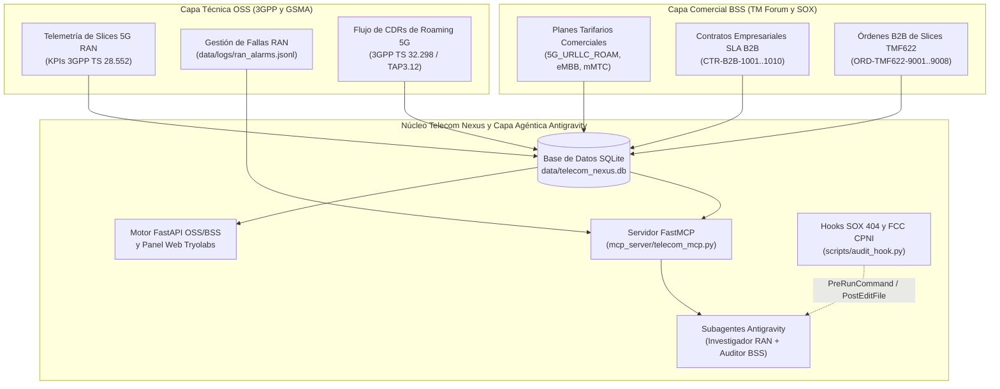

# Telecom Nexus: Plataforma de SLA de Network Slicing 5G, Aseguramiento de Ingresos CDR e Inteligencia de Contratos B2B

<p align="center">
  
</p>

<p align="center">
  <strong>Taller Práctico de Google Antigravity para Equipos de Ingeniería de Telecomunicaciones, NOC/SOC y Aseguramiento de Ingresos</strong><br/>
  <em>Diseñado y Desarrollado por Tryolabs — Práctica de IA para Telecom OSS/BSS</em>
</p>

<p align="center">
  <a href="README.md">English</a> | <strong>Español</strong>
</p>

---

## 1. Descripción General y Contexto de la Industria

Los operadores de telecomunicaciones modernos operan en dos dominios históricamente desconectados:
- **OSS Técnico (Operations Support Systems)**: Contadores de rendimiento de slices de Red de Acceso por Radio (RAN) 5G en tiempo real bajo **3GPP TS 28.552** (`DL_PRB_UTIL_PCT`, `RAN_LATENCY_MS`, `PACKET_LOSS_PCT`), **alarmas activas de gNodeB en JSONL** y flujos de alto volumen de registros de llamadas/datos (CDRs) bajo **3GPP TS 32.298 / GSMA TAP3.12**.
- **BSS Comercial (Business Support Systems)**: **Contratos Empresariales B2B de SLA de Network Slicing** (`URLLC`, `eMBB`, `mMTC`), Órdenes de Producto B2B bajo **TM Forum TMF622** y **Planes Tarifarios Comerciales de Roaming**.

**Telecom Nexus** es una plataforma completa y autónoma basada en **FastAPI + SQLite + Model Context Protocol (MCP)** que conecta la telemetría OSS técnica con los contratos BSS comerciales. A lo largo de **cuatro laboratorios prácticos progresivos**, personalizará **Google Antigravity** utilizando **Reglas (Rules), Habilidades (Skills), Flujos de Trabajo (Workflows), Servidores MCP, Hooks de Cumplimiento y Subagentes Multi-Agente** para detectar fugas de ingresos de roaming 5G no facturadas, auditar penalizaciones de SLA B2B, aplicar controles SOX 404 / FCC CPNI y automatizar la factibilidad de órdenes TMF622.

---

## 2. Arquitectura del Sistema



---

## 3. Inicio Rápido (macOS, Linux y Windows)

### Requisitos Previos
- **Python 3.10+**
- **Google Antigravity** (IDE o CLI `agy`)

### 1. Instalación y Siembra de Datos en Un Solo Comando

**macOS / Linux:**
```bash
./install.sh
```

**Windows (PowerShell):**
```powershell
.\install.ps1
```

Este comando crea el entorno `.venv`, instala todas las dependencias (`fastapi`, `uvicorn`, `pydantic`, `pytest`, `httpx`, `mcp`), siembra la base de datos SQLite determinista (`data/telecom_nexus.db`) + exportaciones CSV (`data/exports/*.csv`) + alarmas RAN (`data/logs/ran_alarms.jsonl`), y configura el espacio de trabajo para el **Laboratorio 01**.

### 2. Iniciar el Panel Web OSS/BSS en Vivo

```bash
source .venv/bin/activate
uvicorn src.main:app --reload --port 8001
```

Abra **`http://127.0.0.1:8001`** en su navegador (o mediante el comando `/browser` de Antigravity) para inspeccionar el panel en vivo de **Tryolabs Telecom Nexus**, los endpoints de la API REST (`/api/summary`, `/api/cdr-leakage`, `/api/sla-breaches`, `/api/order-feasibility`) y la documentación interactiva Swagger (`/docs`).

---

## 4. Plan de Estudios del Taller (4 Laboratorios Progresivos)

Cada laboratorio es 100% autónomo e incluye `install.sh` (configura el estado inicial), `apply_solution.sh` (aplica la solución de referencia) y `verify.sh` (ejecuta la verificación automatizada con `pytest`).

| Lab | Título y Escenario Telecom | Capacidades de Antigravity Cubiertas | Guías y Prompts |
| :--- | :--- | :--- | :--- |
| **Lab 01** | **Aseguramiento de Ingresos 5G y Triaje de SLA de Network Slicing**<br/>Diagnostique y corrija `$54,672.22` en excedentes no facturados de CDRs TAP3.12 (`5G_URLLC_ROAM`) y elimine `$35,000` en falsos positivos de penalización SLA sobre el contrato suspendido `CTR-B2B-1007`. | Investigación de Código, Triaje Automatizado (`pytest`), Verificación UI con `/browser` | [README (ES)](labs/lab-01-revenue-sla-triage/README.es.md) \| [EN](labs/lab-01-revenue-sla-triage/README.md)<br/>[PROMPTS (ES)](labs/lab-01-revenue-sla-triage/PROMPTS.es.md) \| [EN](labs/lab-01-revenue-sla-triage/PROMPTS.md)<br/>[PDF (ES)](labs/lab-01-revenue-sla-triage/LAB_01_INSTRUCTIONS_ES.pdf) \| [EN](labs/lab-01-revenue-sla-triage/LAB_01_INSTRUCTIONS_EN.pdf) |
| **Lab 02** | **Reglas de Dominio 3GPP y FCC CPNI, Habilidades y Flujos de Trabajo**<br/>Codifique umbrales KPI de 3GPP TS 28.552 y enmascaramiento de suscriptores FCC CPNI en personalizaciones del espacio de trabajo y genere una auditoría JSON determinista de SLA (`$224,500.00` de exposición activa, `$279,172.22` de riesgo comercial combinado). | `GEMINI.md`, `.agents/rules/`, `.agents/skills/` (`sla-revenue-audit`) | [README (ES)](labs/lab-02-rules-and-skills/README.es.md) \| [EN](labs/lab-02-rules-and-skills/README.md)<br/>[PROMPTS (ES)](labs/lab-02-rules-and-skills/PROMPTS.es.md) \| [EN](labs/lab-02-rules-and-skills/PROMPTS.md)<br/>[PDF (ES)](labs/lab-02-rules-and-skills/LAB_02_INSTRUCTIONS_ES.pdf) \| [EN](labs/lab-02-rules-and-skills/LAB_02_INSTRUCTIONS_EN.pdf) |
| **Lab 03** | **Servidor MCP OSS/BSS en Vivo y Hooks de Cumplimiento SOX/CPNI**<br/>Exponga telemetría OSS/BSS en vivo y factibilidad de órdenes TMF622 mediante FastMCP, y aplique hooks de seguridad `PreToolUse` / `PreRunCommand` que bloquean SQL destructivo (`DROP TABLE`). | `.agents/mcp_config.json`, Herramientas `FastMCP`, `.agents/hooks.json` (`PreToolUse`, `PostToolUse`) | [README (ES)](labs/lab-03-mcp-and-hooks/README.es.md) \| [EN](labs/lab-03-mcp-and-hooks/README.md)<br/>[PROMPTS (ES)](labs/lab-03-mcp-and-hooks/PROMPTS.es.md) \| [EN](labs/lab-03-mcp-and-hooks/PROMPTS.md)<br/>[PDF (ES)](labs/lab-03-mcp-and-hooks/LAB_03_INSTRUCTIONS_ES.pdf) \| [EN](labs/lab-03-mcp-and-hooks/LAB_03_INSTRUCTIONS_EN.pdf) |
| **Lab 04** | **Capstone Multi-Agente OSS/BSS: Google ADK, Protocolo A2A, `adk web` y Gemini Enterprise**<br/>Orqueste `RANSliceCapacityAgent` (OSS) y `BSSCommercialSLAAgent` (BSS) con **Google ADK**, exponga un servidor de **Protocolo A2A** (`/.well-known/agent.json` y `/api/v1/a2a`), pruebe en **ADK Dev UI (`adk web`)** y despliegue en **Cloud Run + Gemini Enterprise** vía **Terraform**. | Google ADK (`google-adk`), Protocolo A2A (JSON-RPC 2.0), `adk web`, Terraform (`infra/terraform/`), Registro en Gemini Enterprise | [README (ES)](labs/lab-04-multi-agent-capstone/README.es.md) \| [EN](labs/lab-04-multi-agent-capstone/README.md)<br/>[PROMPTS (ES)](labs/lab-04-multi-agent-capstone/PROMPTS.es.md) \| [EN](labs/lab-04-multi-agent-capstone/PROMPTS.md)<br/>[PDF (ES)](labs/lab-04-multi-agent-capstone/LAB_04_INSTRUCTIONS_ES.pdf) \| [EN](labs/lab-04-multi-agent-capstone/LAB_04_INSTRUCTIONS_EN.pdf) |

---

## 5. Seguridad Empresarial, Cumplimiento y Gobernanza en Telecomunicaciones

Los operadores de telecomunicaciones operan bajo estrictos marcos regulatorios (**FCC CPNI** 47 U.S.C. § 222, **SOX Sección 404** para sistemas de facturación, **GDPR** y **estándares de seguridad 3GPP**). El despliegue de Google Antigravity en un entorno de operador empresarial utiliza un **modelo de gobernanza de defensa en profundidad** en dos capas:

### Capa 1: Gobernanza en Google Cloud y Gemini Enterprise
1. **Gestión de Identidad y Acceso (Cloud IAM)**: El acceso a Gemini Enterprise está gobernado por Google Cloud IAM (`roles/cloudaicompanion.user`) federado con proveedores de identidad corporativos (Okta, Microsoft Entra ID, Ping Identity).
2. **Registro Centralizado de Auditoría (Cloud Audit Logs)**: Las acciones administrativas y las invocaciones de API a `cloudaicompanion.googleapis.com` se capturan en **Google Cloud Audit Logs** y pueden transmitirse a **BigQuery** o **Google SecOps (Chronicle SIEM)** para monitoreo del SOC.
3. **Cero Entrenamiento con Datos del Cliente**: Ni su código fuente OSS/BSS, ni sus prompts, ni su telemetría 3GPP o esquemas de suscriptores se utilizan jamás para entrenar modelos fundacionales de Google.
4. **Aislamiento de Red e Indemnización de Propiedad Intelectual**: Soporte completo para perímetros de **VPC Service Controls (VPC-SC)**, Private Google Access e **Indemnización de Propiedad Intelectual de IA Generativa** de Google Cloud.

### Capa 2: Controles de Seguridad del Cliente y Espacio de Trabajo de Antigravity
1. **Política de Ejecución de Herramientas (`Turbo` / `Auto` / `Ask`)**: Aplica aprobación humana en el ciclo (`Ask`) antes de ejecutar comandos de terminal o modificar módulos críticos de facturación.
2. **Sandbox de Terminal a Nivel de Sistema Operativo**: Utiliza **macOS Seatbelt (`sandbox-exec`)** y **Linux Bubblewrap (`bwrap`)** para aislar la ejecución de subprocesos.
3. **Restricción de Acceso a Archivos Fuera del Workspace**: Impide que los agentes accedan a archivos fuera de la raíz autorizada del proyecto.
4. **Política de Acceso a Internet (`enabled` / `allowlist` / `disabled`)**: Restringe las llamadas de red salientes únicamente a dominios corporativos internos aprobados.
5. **Lista Blanca y Negra de Comandos (Allowlist & Denylist)**: Bloquea patrones peligrosos de CLI (`rm -rf`, `DROP TABLE`, exportación de credenciales de producción).
6. **Lista Blanca del Navegador (Browser Allowlist)**: Restringe la herramienta `/browser` a portales web internos verificados (`http://127.0.0.1:8001`).
7. **Hooks Deterministas de Cumplimiento (`.agents/hooks.json`)**: Como se implementa en el **Laboratorio 03**, los hooks del espacio de trabajo interceptan eventos `PreToolUse` (`PreRunCommand`) y `PostToolUse` (`PostEditFile`) de forma síncrona, bloqueando comandos SQL destructivos con `"decision": "deny"` y registrando una pista de auditoría JSON inmutable (`data/logs/hook_audit.log`).

---

## 6. Estructura del Repositorio

```text
antigravity-workshop-telecom/
├── README.md                          # Guía Principal del Taller (Inglés)
├── README.es.md                       # Guía Principal del Taller (Español)
├── install.sh / install.ps1           # Instalación en un paso y siembra de datos
├── pyproject.toml / requirements.txt  # Dependencias de Python y configuración de pytest
├── data/
│   ├── seed_telecom_data.py           # Generador determinista de datos OSS/BSS
│   ├── telecom_nexus.db               # Base de datos SQLite sembrada (RAN, CDRs, Contratos, TMF622)
│   ├── exports/                       # Exportaciones CSV y reportes de auditoría generados
│   └── logs/ran_alarms.jsonl          # Alarmas activas gNodeB 3GPP (JSONL)
├── src/
│   ├── main.py                        # Servidor FastAPI OSS/BSS y Panel Web
│   ├── database.py                    # Conector SQLite
│   ├── models.py                      # Esquemas Pydantic OSS/BSS
│   ├── services/                      # Motores de tasación CDR, monitor SLA, Contratos y Órdenes
│   └── static/                        # Panel Web con marca Tryolabs (index.html + logo)
├── mcp_server/
│   └── telecom_mcp.py                 # Servidor FastMCP que expone 4 herramientas OSS/BSS en vivo
├── scripts/
│   ├── run_sla_audit.py               # CLI determinista de correlación SLA y RAN
│   └── audit_hook.py                  # Hook PreRunCommand/PostEditFile SOX 404 y FCC CPNI
├── labs/
│   ├── lab-01-revenue-sla-triage/     # Starter, solución, scripts y guías bilingües del Lab 01
│   ├── lab-02-rules-and-skills/       # Starter, solución, scripts y guías bilingües del Lab 02
│   ├── lab-03-mcp-and-hooks/          # Starter, solución, scripts y guías bilingües del Lab 03
│   └── lab-04-multi-agent-capstone/   # Starter, solución, scripts y guías bilingües del Lab 04
└── tests/                             # Suites automatizadas de pytest para los Labs 01, 02, 03 y 04
```
