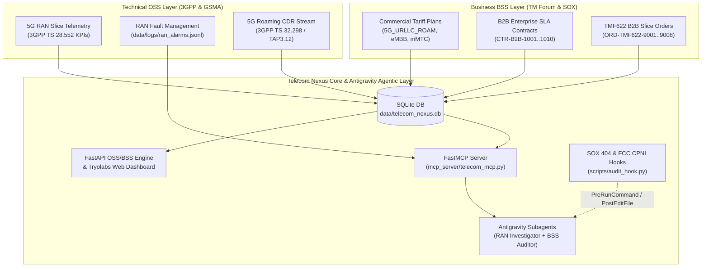

# Telecom Nexus: 5G Network Slice SLA, CDR Revenue Assurance & B2B Contract Intelligence Platform

<p align="center">
  
</p>

<p align="center">
  <strong>Hands-On Google Antigravity Workshop for Telecommunications Engineering, NOC/SOC & Revenue Assurance Teams</strong><br/>
  <em>Designed & Engineered by Tryolabs — Telecom OSS/BSS AI Practice</em>
</p>

<p align="center">
  <strong>English</strong> | <a href="README.es.md">Español</a> | <a href="INSTRUCTOR_DEMO_GUIDE.md">Instructor Guide (EN)</a> | <a href="INSTRUCTOR_DEMO_GUIDE.es.md">Guía del Instructor (ES)</a>
</p>

---

## 1. Overview & Industry Context

Modern telecommunications carriers operate across two historically disconnected domains:
- **Technical OSS (Operations Support Systems)**: Real-time **3GPP TS 28.552** 5G Radio Access Network (RAN) slice performance counters (`DL_PRB_UTIL_PCT`, `RAN_LATENCY_MS`, `PACKET_LOSS_PCT`), active **gNodeB JSONL alarms**, and high-volume **3GPP TS 32.298 / GSMA TAP3.12** Call Detail Records (CDRs).
- **Business BSS (Business Support Systems)**: Enterprise **B2B Network Slice SLA Contracts** (`URLLC`, `eMBB`, `mMTC`), **TM Forum TMF622** B2B Product Orders, and **Commercial Roaming Tariff Plans**.

**Telecom Nexus** is a complete, self-contained **FastAPI + SQLite + Model Context Protocol (MCP)** platform that bridges Technical OSS telemetry with Business BSS contracts. Across **four progressive hands-on labs**, you will customize **Google Antigravity** using **Rules, Skills, Workflows, MCP Servers, Compliance Hooks, and Multi-Agent Subagents** to detect unbilled 5G roaming revenue leakage, audit B2B SLA penalties, enforce SOX 404 / FCC CPNI compliance, and automate TMF622 order feasibility.

---

## 2. System Architecture



---

## 3. Quickstart (macOS, Linux & Windows)

### Prerequisites
- **Python 3.10+**
- **Google Antigravity** (IDE or `agy` CLI)

### 1. One-Command Installation & Data Seeding

**macOS / Linux:**
```bash
./install.sh
```

**Windows (PowerShell):**
```powershell
.\install.ps1
```

This creates `.venv`, installs all dependencies (`fastapi`, `uvicorn`, `pydantic`, `pytest`, `httpx`, `mcp`), seeds the deterministic SQLite database (`data/telecom_nexus.db`) + CSV exports (`data/exports/*.csv`) + RAN alarms (`data/logs/ran_alarms.jsonl`), and configures the workspace for **Lab 01**.

### 2. Launch the Live OSS/BSS Web Dashboard

```bash
source .venv/bin/activate
uvicorn src.main:app --reload --port 8000
```

Open **`http://127.0.0.1:8000`** in your browser (or via Antigravity's `/browser` command) to inspect the live **Tryolabs Telecom Nexus** dashboard, REST API endpoints (`/api/summary`, `/api/cdr-leakage`, `/api/sla-breaches`, `/api/order-feasibility`), and interactive Swagger docs (`/docs`).

---

## 4. Workshop Curriculum (4 Progressive Labs)

Each lab is 100% self-contained with `install.sh` (sets up the starter state), `apply_solution.sh` (applies the reference solution), and `verify.sh` (runs automated `pytest` verification).

| Lab | Title & Telecom Scenario | Antigravity Capabilities Covered | Guides & Prompts |
| :--- | :--- | :--- | :--- |
| **Lab 01** | **5G Revenue Assurance & Network Slice SLA Triage**<br/>Diagnose and fix `$55,392.45` in unbilled `5G_URLLC_ROAM` TAP3.12 CDR overages and eliminate `$35,000` in false-positive SLA penalties on `SUSPENDED` contract `CTR-B2B-1007`. | Codebase Investigation, Automated Test Triage (`pytest`), `/browser` UI Verification | [README (EN)](labs/lab-01-revenue-sla-triage/README.md) \| [ES](labs/lab-01-revenue-sla-triage/README.es.md)<br/>[PROMPTS (EN)](labs/lab-01-revenue-sla-triage/PROMPTS.md) \| [ES](labs/lab-01-revenue-sla-triage/PROMPTS.es.md) |
| **Lab 02** | **3GPP & FCC CPNI Domain Rules, Skills & Workflows**<br/>Codify 3GPP TS 28.552 KPI thresholds and FCC CPNI subscriber masking into workspace customizations and generate a deterministic JSON SLA breach audit (`$224,500.00` active exposure). | `.agents/rules/`, `.agents/skills/`, `.agents/workflows/` (`/slice-sla-triage`) | [README (EN)](labs/lab-02-rules-and-skills/README.md) \| [ES](labs/lab-02-rules-and-skills/README.es.md)<br/>[PROMPTS (EN)](labs/lab-02-rules-and-skills/PROMPTS.md) \| [ES](labs/lab-02-rules-and-skills/PROMPTS.es.md) |
| **Lab 03** | **Live OSS/BSS MCP Server & SOX/CPNI Compliance Hooks**<br/>Expose live SQLite OSS/BSS telemetry and TMF622 order feasibility via FastMCP, and enforce deterministic `PreRunCommand` / `PostEditFile` security hooks that block destructive SQL (`DROP TABLE`). | `.mcp.json`, `FastMCP` Tools, `.agents/hooks.json` (`PreRunCommand`, `PostEditFile`) | [README (EN)](labs/lab-03-mcp-and-hooks/README.md) \| [ES](labs/lab-03-mcp-and-hooks/README.es.md)<br/>[PROMPTS (EN)](labs/lab-03-mcp-and-hooks/PROMPTS.md) \| [ES](labs/lab-03-mcp-and-hooks/PROMPTS.es.md) |
| **Lab 04** | **Multi-Agent OSS/BSS Capstone: TMF622 Order Feasibility**<br/>Orchestrate a **RAN OSS Investigator** subagent and a **BSS Revenue & Order Auditor** subagent to evaluate 8 pending TMF622 B2B 5G Slice orders (`3` feasible, `5` contended) and publish an Executive Advisory. | `.agents/agents/` Subagents, `/teamwork`, `/plan`, Multi-Agent Orchestration | [README (EN)](labs/lab-04-multi-agent-capstone/README.md) \| [ES](labs/lab-04-multi-agent-capstone/README.es.md)<br/>[PROMPTS (EN)](labs/lab-04-multi-agent-capstone/PROMPTS.md) \| [ES](labs/lab-04-multi-agent-capstone/PROMPTS.es.md) |

---

## 5. Enterprise Security, Compliance & Governance in Telecom

Telecommunications providers operate under strict regulatory frameworks (**FCC CPNI** 47 U.S.C. § 222, **SOX Section 404** for billing systems, **GDPR**, and **3GPP security standards**). Deploying Google Antigravity in an enterprise carrier environment utilizes a **defense-in-depth governance model** across two layers:

### Layer 1: Google Cloud & Gemini Enterprise Governance
1. **Identity & Access Management (Cloud IAM)**: Access to Gemini Enterprise is governed by Google Cloud IAM (`roles/cloudaicompanion.user`) federated with corporate identity providers (Okta, Microsoft Entra ID, Ping Identity).
2. **Centralized Cloud Audit Logging**: Administrative actions and API invocations to `cloudaicompanion.googleapis.com` are captured in **Google Cloud Audit Logs** and can be streamed to **BigQuery** or **Google SecOps (Chronicle SIEM)** for SOC monitoring.
3. **Zero Customer Data Training**: Neither your OSS/BSS source code, prompts, 3GPP telemetry, nor subscriber schemas are ever used to train Google foundation models.
4. **Network Isolation & IP Indemnification**: Full support for **VPC Service Controls (VPC-SC)** perimeters, Private Google Access, and Google Cloud's **Generative AI Intellectual Property Indemnification**.

### Layer 2: Antigravity Client & Workspace Security Controls
1. **Tool Execution Policy (`Turbo` / `Auto` / `Ask`)**: Enforce human-in-the-loop approval (`Ask`) before running shell commands or modifying critical billing modules.
2. **OS-Level Terminal Sandbox**: Uses **macOS Seatbelt (`sandbox-exec`)** and **Linux Bubblewrap (`bwrap`)** to isolate subprocess execution.
3. **Non-Workspace File Access Restriction**: Prevents agents from accessing files outside the authorized project root.
4. **Internet Access Policy (`enabled` / `allowlist` / `disabled`)**: Locks outbound network calls to approved internal corporate domains.
5. **Command Allowlist & Denylist**: Blocks hazardous CLI patterns (`rm -rf`, `DROP TABLE`, production credential exports).
6. **Browser Allowlist**: Restricts the `/browser` tool to verified internal web portals (`http://127.0.0.1:8000`).
7. **Deterministic Compliance Hooks (`.agents/hooks.json`)**: As implemented in **Lab 03**, workspace hooks intercept `PreRunCommand` and `PostEditFile` events synchronously—blocking destructive SQL commands with exit code `2` and recording an immutable JSON audit log (`data/logs/hook_audit.log`).

---

## 6. Repository Structure

```text
antigravity-workshop-telecom/
├── README.md                          # Main Workshop Guide (English)
├── README.es.md                       # Guía Principal del Taller (Español)
├── INSTRUCTOR_DEMO_GUIDE.md           # Facilitator Live Demo Script (English)
├── INSTRUCTOR_DEMO_GUIDE.es.md        # Guía de Demostración en Vivo (Español)
├── install.sh / install.ps1           # One-step environment setup & data seeding
├── pyproject.toml / requirements.txt  # Python dependencies & pytest configuration
├── data/
│   ├── seed_telecom_data.py           # Deterministic OSS/BSS dataset generator
│   ├── telecom_nexus.db               # Seeded SQLite database (RAN, CDRs, Contracts, TMF622)
│   ├── exports/                       # CSV exports & generated audit reports
│   └── logs/ran_alarms.jsonl          # 3GPP gNodeB active alarms (JSONL)
├── src/
│   ├── main.py                        # FastAPI OSS/BSS API & Web Dashboard server
│   ├── database.py                    # SQLite connection helper
│   ├── models.py                      # Pydantic OSS/BSS schemas
│   ├── services/                      # Core CDR rating, SLA monitor, Contract & Order engines
│   └── static/                        # Tryolabs-branded Web Dashboard (index.html + logo)
├── mcp_server/
│   └── telecom_mcp.py                 # FastMCP server exposing 4 live OSS/BSS tools
├── scripts/
│   ├── run_sla_audit.py               # Deterministic SLA & RAN correlation CLI
│   └── audit_hook.py                  # SOX 404 & FCC CPNI PreRunCommand/PostEditFile hook
├── labs/
│   ├── lab-01-revenue-sla-triage/     # Lab 01 starter, solution, scripts & bilingual guides
│   ├── lab-02-rules-and-skills/       # Lab 02 starter, solution, scripts & bilingual guides
│   ├── lab-03-mcp-and-hooks/          # Lab 03 starter, solution, scripts & bilingual guides
│   └── lab-04-multi-agent-capstone/   # Lab 04 starter, solution, scripts & bilingual guides
└── tests/                             # Automated pytest suites for Labs 01, 02, 03 & 04
```
