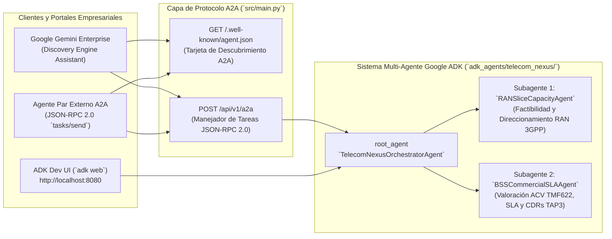

# Laboratorio 04: Capstone Multi-Agente OSS/BSS — Google ADK, Protocolo A2A, ADK Dev UI (`adk web`), Terraform y Gemini Enterprise

<p align="center">
  
</p>

> **Idioma / Language:** [Español](./README.es.md) | [English](./README.md) • **Guía de Prompts:** [PROMPTS.es.md](./PROMPTS.es.md) | [PROMPTS.md](./PROMPTS.md) • **PDF:** [ES](./LAB_04_INSTRUCTIONS_ES.pdf) | [EN](./LAB_04_INSTRUCTIONS_EN.pdf)

---

## 1. Escenario Comercial y Técnico de Telecomunicaciones

La Mesa de Ventas Empresariales B2B tiene **15 órdenes pendientes TM Forum TMF622 de Network Slicing 5G** (`ORD-TMF622-9001` a `ORD-TMF622-9015`) que representan millones en Valor Anual de Contrato (ACV). Antes de aprovisionar un slice en un Código de Área de Seguimiento (TAC), la plataforma debe coordinar **dos dominios especializados de ingeniería de telecomunicaciones**:

1. **Dominio Técnico OSS (`RANSliceCapacityAgent`)**: Evalúa las celdas 5G RAN bajo 3GPP TS 28.552 en el TAC objetivo (`prb_utilization_pct < 80.0`, `pdcp_latency_ms <= max_latency_ms`, `available_bandwidth_mbps >= requested_bandwidth_mbps`). Si la celda primaria está congestionada (`>= 80%` PRB) y existe una celda vecina saludable en `neighbor_cells`, puede ejecutar **remediación autónoma de slice** (direccionamiento de tráfico a celda vecina + reasignación de PRB).
2. **Dominio Comercial BSS (`BSSCommercialSLAAgent`)**: Cuantifica el Valor Anual de Contrato protegido (`MRR * 12`), la exposición evitada a penalizaciones SLA (`MRR * 2`), los incumplimientos regionales activos de SLA B2B y la fuga de ingresos en CDRs de roaming GSMA TAP3.12.

En este laboratorio capstone, utilizará **Google Antigravity** (y `/plan` o `/teamwork`) para:
- Implementar el **Motor de Factibilidad de Órdenes TMF622 y Remediación de Slices** (`src/services/order_feasibility.py`).
- Construir un **Orquestador Multi-Agente con Google ADK (Agent Development Kit)** (`src/agents/adk_a2a_orchestrator.py` y `adk_agents/telecom_nexus/agent.py`) coordinando `RANSliceCapacityAgent` y `BSSCommercialSLAAgent`.
- Exponer el sistema multi-agente mediante el **Protocolo A2A (Agent2Agent)** (`GET /.well-known/agent.json` Agent Card y `POST /api/v1/a2a` JSON-RPC 2.0 `tasks/send`).
- Probar su grafo multi-agente de forma interactiva en su laptop usando la **Interfaz de Desarrollo ADK (`adk web`)** (`./scripts/run_adk_web.sh` en `http://localhost:8080`).
- Validar el despliegue en la nube con **Terraform (`infra/terraform/`)** y registrar el agente A2A en **Google Gemini Enterprise** (`./deploy/deploy_gcp.sh --dry-run`).

---

## 2. Arquitectura Multi-Agente ADK + A2A + Gemini Enterprise



---

## 3. Instrucciones Paso a Paso

### Paso 1: Inicializar el Estado Inicial del Laboratorio 04

```bash
./labs/lab-04-multi-agent-capstone/install.sh
```

Esto asegura que las soluciones de los Laboratorios 01–03 estén activas y establece `src/services/order_feasibility.py` y `src/agents/adk_a2a_orchestrator.py` en sus plantillas iniciales del Laboratorio 04.

### Paso 2: Implementar Factibilidad de Órdenes TMF622 y Direccionamiento Autónomo de Slices
Abra [PROMPTS.es.md](PROMPTS.es.md) y pegue el **Prompt 1** en Antigravity para implementar `evaluate_order_feasibility()` y `remediate_slice_for_order()` en `src/services/order_feasibility.py`.

### Paso 3: Construir el Orquestador Multi-Agente Google ADK y el Servidor de Protocolo A2A
Pegue el **Prompt 2** de [PROMPTS.es.md](PROMPTS.es.md) en Antigravity para completar `src/agents/adk_a2a_orchestrator.py`:
- `RANSliceCapacityAgent.assess_order_ran_slice(order_id, auto_remediate)`
- `BSSCommercialSLAAgent.assess_commercial_impact(order_id, oss_result)`
- `TelecomNexusOrchestratorAgent.run_order_assessment(order_id, auto_remediate)`
- `get_a2a_agent_card(base_url)` (`GET /.well-known/agent.json`)
- `handle_a2a_jsonrpc_request(payload)` (`POST /api/v1/a2a`)

### Paso 4: Pruebas Locales Interactivas con la Interfaz de Desarrollo ADK (`adk web`)
Inicie la **Interfaz de Desarrollo de Google ADK** localmente para inspeccionar su `root_agent` (`telecom_nexus`), los subagentes (`ran_slice_capacity_agent`, `bss_commercial_sla_agent`, `a2a_protocol_bridge_agent`), llamadas a herramientas y transiciones de estado:

```bash
# Validar el paquete de agentes ADK y la configuración de conexión a Gemini Enterprise:
./scripts/run_adk_web.sh --check

# Iniciar la interfaz interactiva ADK Web UI en http://localhost:8080:
./scripts/run_adk_web.sh
```

Dentro de `http://localhost:8080`, seleccione **`telecom_nexus`** en el menú desplegable de agentes y pruebe consultas como:
- *"Evalúa la orden TMF622 ORD-TMF622-9001 usando el Agente de Capacidad RAN y el Agente Comercial SLA BSS."*
- *"Ejecuta remediación autónoma de slice 5G para ORD-TMF622-9001 y calcula el Valor Anual de Contrato protegido."*
- *"Envía una tarea JSON-RPC A2A para ORD-TMF622-9003."*

También puede iniciar el **Dashboard Web FastAPI de Telecom Nexus** en el puerto `8001` (`./.venv/bin/uvicorn src.main:app --reload --port 8001`) y abrir `http://127.0.0.1:8001/es` (o usar el selector **`EN | ES`** en la esquina superior derecha) para probar en vivo los botones **Verificar Factibilidad** y **Remediar Slice**.

### Paso 5: Desplegar con Terraform y Registrar en Google Gemini Enterprise
Revise la configuración de Terraform en `infra/terraform/` (`versions.tf`, `variables.tf`, `main.tf`, `outputs.tf`) y el script de registro A2A en Gemini Enterprise en `deploy/register_gemini_enterprise_agent.sh`.

Ejecute la validación local en modo `dry-run` (sin requerir credenciales activas de GCP):
```bash
./labs/lab-04-multi-agent-capstone/deploy_gcp.sh --dry-run
```

Para desplegar en un proyecto real de Google Cloud con Gemini Enterprise:
```bash
export GOOGLE_CLOUD_PROJECT="su-proyecto-telecom-gcp"
export GEMINI_ENTERPRISE_APP_ID="telecom-nexus-enterprise-app"
./labs/lab-04-multi-agent-capstone/deploy_gcp.sh --project "$GOOGLE_CLOUD_PROJECT" --gemini-app-id "$GEMINI_ENTERPRISE_APP_ID"
```

### Paso 6: Verificar su Solución del Laboratorio 04

```bash
# Opcional: Aplicar la solución de referencia
./labs/lab-04-multi-agent-capstone/apply_solution.sh

# Ejecutar la suite completa de 21 pruebas de verificación de los Labs 01–04
./labs/lab-04-multi-agent-capstone/verify.sh
```
