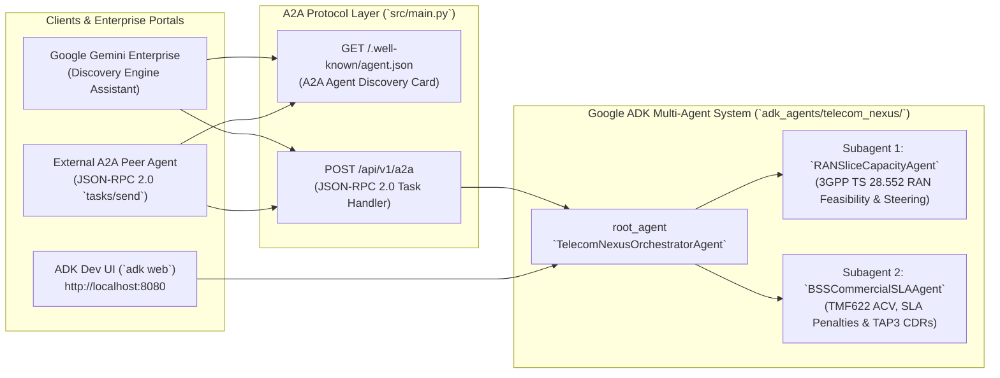

# Lab 04: Multi-Agent OSS/BSS Capstone — Google ADK, A2A Protocol, ADK Dev UI (`adk web`), Terraform & Gemini Enterprise

<p align="center">
  
</p>

> **Language / Idioma:** [English](./README.md) | [Español](./README.es.md) • **Prompt Playbook:** [PROMPTS.md](./PROMPTS.md) | [PROMPTS.es.md](./PROMPTS.es.md) • **PDF:** [EN](./LAB_04_INSTRUCTIONS_EN.pdf) | [ES](./LAB_04_INSTRUCTIONS_ES.pdf)

---

## 1. Telecom Business & Technical Scenario

Your Enterprise B2B Sales Desk has **15 pending TM Forum TMF622 5G Network Slice Orders** (`ORD-TMF622-9001` through `ORD-TMF622-9015`) representing millions in Annual Contract Value (ACV). Before provisioning a slice in a Tracking Area Code (TAC), your platform must coordinate **two specialized telecom engineering domains**:

1. **Technical OSS Domain (`RANSliceCapacityAgent`)**: Evaluates 3GPP TS 28.552 5G RAN cells in the target TAC (`prb_utilization_pct < 80.0`, `pdcp_latency_ms <= max_latency_ms`, `available_bandwidth_mbps >= requested_bandwidth_mbps`). If the primary cell is congested (`>= 80%` PRB) and a healthy neighbor cell is listed in `neighbor_cells`, it can execute **autonomous slice remediation** (neighbor traffic steering + PRB reallocation).
2. **Commercial BSS Domain (`BSSCommercialSLAAgent`)**: Quantifies the order's protected Annual Contract Value (`MRR * 12`), avoided SLA penalty exposure (`MRR * 2`), regional active B2B SLA breaches, and unbilled GSMA TAP3.12 CDR revenue leakage.

In this capstone lab, you will use **Google Antigravity** (and `/plan` or `/teamwork`) to:
- Implement the **TMF622 Order Feasibility & Slice Remediation Engine** (`src/services/order_feasibility.py`).
- Build a **Google ADK (Agent Development Kit) Multi-Agent Orchestrator** (`src/agents/adk_a2a_orchestrator.py` and `adk_agents/telecom_nexus/agent.py`) coordinating `RANSliceCapacityAgent` and `BSSCommercialSLAAgent`.
- Expose the multi-agent system over the **A2A (Agent2Agent) Protocol** (`GET /.well-known/agent.json` Agent Card and `POST /api/v1/a2a` JSON-RPC 2.0 `tasks/send`).
- Test your multi-agent graph interactively on your laptop using the **ADK Development UI (`adk web`)** (`./scripts/run_adk_web.sh` at `http://localhost:8080`).
- Validate cloud deployment via **Terraform (`infra/terraform/`)** and register the A2A agent into **Google Gemini Enterprise** (`./deploy/deploy_gcp.sh --dry-run`).

---

## 2. Multi-Agent ADK + A2A + Gemini Enterprise Architecture



---

## 3. Step-by-Step Instructions

### Step 1: Initialize Lab 04 Starter State

```bash
./labs/lab-04-multi-agent-capstone/install.sh
```

This ensures Labs 01–03 solutions are active and sets `src/services/order_feasibility.py` and `src/agents/adk_a2a_orchestrator.py` to their Lab 04 starter stubs.

### Step 2: Implement TMF622 Order Feasibility & Autonomous Slice Steering
Open [PROMPTS.md](PROMPTS.md) and paste **Prompt 1** into Antigravity to implement `evaluate_order_feasibility()` and `remediate_slice_for_order()` in `src/services/order_feasibility.py`.

### Step 3: Build the Google ADK Multi-Agent Orchestrator & A2A Protocol Server
Paste **Prompt 2** from [PROMPTS.md](PROMPTS.md) into Antigravity to complete `src/agents/adk_a2a_orchestrator.py`:
- `RANSliceCapacityAgent.assess_order_ran_slice(order_id, auto_remediate)`
- `BSSCommercialSLAAgent.assess_commercial_impact(order_id, oss_result)`
- `TelecomNexusOrchestratorAgent.run_order_assessment(order_id, auto_remediate)`
- `get_a2a_agent_card(base_url)` (`GET /.well-known/agent.json`)
- `handle_a2a_jsonrpc_request(payload)` (`POST /api/v1/a2a`)

### Step 4: Interactive Local Testing with the ADK Development UI (`adk web`)
Launch the **Google ADK Development UI** locally to inspect your `root_agent` (`telecom_nexus`), subagents (`ran_slice_capacity_agent`, `bss_commercial_sla_agent`, `a2a_protocol_bridge_agent`), tool calls, and state transitions:

```bash
# Validate the ADK agent package and Gemini Enterprise connection config:
./scripts/run_adk_web.sh --check

# Launch the interactive ADK Web UI at http://localhost:8080:
./scripts/run_adk_web.sh
```

Inside `http://localhost:8080`, select **`telecom_nexus`** from the agent dropdown and test prompts such as:
- *"Evaluate TMF622 order ORD-TMF622-9001 across the RAN Slice Capacity Agent and BSS Commercial SLA Agent."*
- *"Execute autonomous 5G slice remediation for ORD-TMF622-9001 and calculate the protected Annual Contract Value."*
- *"Dispatch an A2A JSON-RPC task for ORD-TMF622-9003."*

You can also launch the **Telecom Nexus FastAPI Web Dashboard** on port `8001` (`./.venv/bin/uvicorn src.main:app --reload --port 8001`) and open `http://127.0.0.1:8001` (or `http://127.0.0.1:8001/es` / the **`EN | ES`** toggle in the top-right header) to test the **Check Feasibility** and **Remediate Slice** buttons live.

### Step 5: Deploy with Terraform & Register in Google Gemini Enterprise
Review the Terraform configuration in `infra/terraform/` (`versions.tf`, `variables.tf`, `main.tf`, `outputs.tf`) and the Gemini Enterprise A2A registration script in `deploy/register_gemini_enterprise_agent.sh`.

Run the local dry-run validation (no live GCP credentials required):
```bash
./labs/lab-04-multi-agent-capstone/deploy_gcp.sh --dry-run
```

When deploying to a live Google Cloud project with Gemini Enterprise:
```bash
export GOOGLE_CLOUD_PROJECT="your-telecom-gcp-project"
export GEMINI_ENTERPRISE_APP_ID="telecom-nexus-enterprise-app"
./labs/lab-04-multi-agent-capstone/deploy_gcp.sh --project "$GOOGLE_CLOUD_PROJECT" --gemini-app-id "$GEMINI_ENTERPRISE_APP_ID"
```

### Step 6: Verify Your Lab 04 Solution

```bash
# Optional: Apply the reference solution
./labs/lab-04-multi-agent-capstone/apply_solution.sh

# Run the complete 21-test verification suite across Labs 01–04
./labs/lab-04-multi-agent-capstone/verify.sh
```
